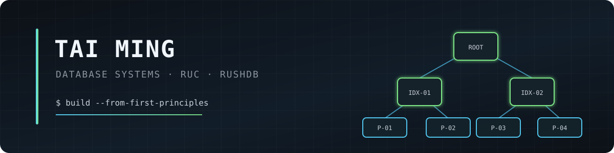
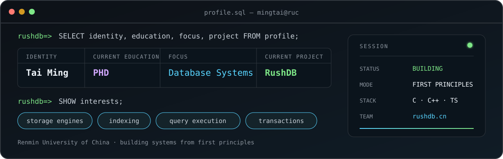
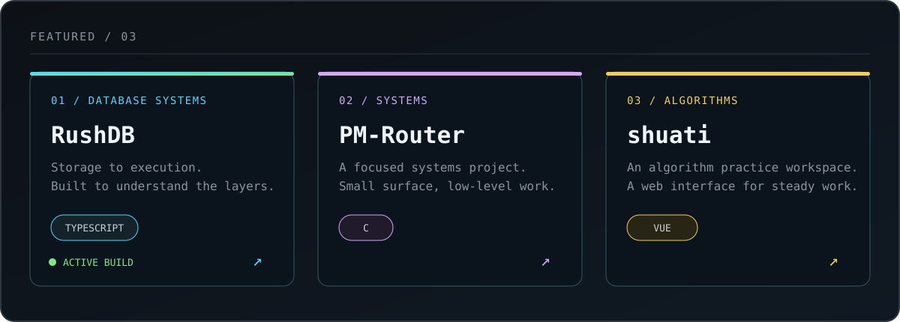

  

  
  
  

  

<h2 align="center">Selected Builds</h2>

  

  <a href="https://github.com/mmmttt000045/rushdb"><b>RushDB</b></a>
  &nbsp;·&nbsp;
  <a href="https://github.com/mmmttt000045/PM-Router"><b>PM-Router</b></a>
  &nbsp;·&nbsp;
  <a href="https://github.com/mmmttt000045/shuati"><b>shuati</b></a>

<h2 align="center">Working Set</h2>

  

 

  <code>storage</code>&nbsp;&nbsp;
  <code>indexing</code>&nbsp;&nbsp;
  <code>query execution</code>&nbsp;&nbsp;
  <code>transactions</code>

  Building from first principles · Open to conversations about database internals and systems engineering

  <code>connection_status: open</code>

